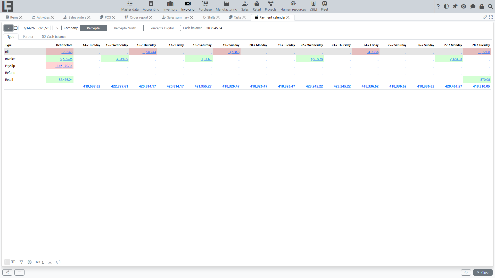

## Debt

In "Invoicing", documents and payments are all treated as **debt entries** with a sign: [bills](bills.md) and incoming payments create debt in one direction, [invoices](invoices.md) and outgoing payments in the other. There are two distinct figures:

- **Partner / contract debt** — the signed sum of all active documents for a [partner](../masterdata/partners.md) or [contract](../masterdata/contracts.md). This total exists as soon as a document exists; it does **not** depend on matching. Amounts are converted to the default currency (unless conversion is switched off in [settings](settings.md)).
- **Remaining (Left)** — for a single document, its amount minus the **matched** payments. This is what decreases when you match a payment.

Points worth understanding:

- a **Canceled** document is excluded from every debt calculation;
- **Overdue debt** is the part of the debt whose **Pay before** date is already in the past;
- matching only affects the document-level **Left**/**Paid** figures; the partner total already reflects the document from the moment it is entered.

The dedicated views **Partner debts** and **Contract debts** list each debt entry (type, number, date, **Pay before**, company, amount, **Left**, running **Debt**) with an **Overdue** filter, and show **Debt** plus **Overdue debt** totals per partner/contract. **Partner debts** also shows, for each entry, the **Days overdue** and the **Aging bucket** it falls into as of today (see [Debt aging](#debt-aging)).

## How debt is closed

1. Create a [payment](payments.md).
2. Match the payment with the document (or match with several documents). Matching can also happen **automatically** when the payment's **Reference** contains the document number.
3. Once matched, the document's remaining amount (**Left**) decreases; when it reaches zero the document is marked **Paid**.

If the payment is matched with several documents, the remaining amount decreases for each document by the corresponding amount.

## Payment calendar

The payment calendar (**Invoicing → Reporting → Payment calendar**) shows the outstanding balance spread across a date range, so you can see when money is due in and out.

Layout:

- pick the **Company** and a **date interval** at the top; **\<** / **\>** jump the interval one month back/forward. The interval starts as *today … today + 14 days*.
- **Cash balance** shows the current balance of the company's accounts.
- **Debt before** is the outstanding balance whose **Pay before** date falls before the interval starts.
- there is then **one column per date** in the interval; each cell holds the net debt change due that day. The column footer shows the **forecast cash** — the running balance (cash balance plus cumulative debt) through that date.
- cells are shaded green (positive) or red (negative).

The calendar has two breakdown tabs — **Type** and **Partner** — plus a cash-balance chart.

 The due date comes from each document's stored **Pay before** value (computed once from the payment terms at entry), not re-derived on the fly.

Clicking a **Debt before** or date cell drills down into the underlying documents (the **Debts** list filtered by company, type, partner and due date).

### What to check if the calendar is “empty” or dates are incorrect

Check:

- whether **payment terms / Pay before** are filled in documents;
- whether the chosen **date interval** actually covers the due dates;
- whether documents are excluded by status (for example, Canceled).

## Debt aging

**Invoicing → Reporting → Debt aging** splits the outstanding debt of every partner by how long it has been overdue, as of a chosen date — the usual aging schedule of receivables and payables.

Layout:

- at the top pick the **Company** and the **Date** (today by default); the **Vendors** switch turns the report from customers (partners that owe the company) to vendors (partners the company owes) — on the vendor side the amounts are shown as positive numbers;
- one row per partner with its **Sales person**, the **Total** debt as of the date, the part whose term has not come yet (**Not due**), one column per aging bucket (**1-30**, **31-60**, **61-90** with the default buckets) and the **> 90** column for debts older than the last bucket;
- the **My customers** filter keeps only the partners whose **Sales person** is the current user;
- the lower table lists the debts of the selected partner with **Days overdue**, the **Aging bucket**, the amount and the **Debt** left as of the date.

How the figures are computed:

- a debt is overdue as of the date when its **Pay before** date is earlier than that date; the days overdue are counted from **Pay before**;
- the debt left as of the date is the document amount less the matched payments dated not later than that date, so the report can be built for a past date as well;
- debts without **Pay before** (for example, unmatched payments) are counted in **Not due**;
- the partner's figures are net, like **Debt** and **Overdue debt** on the partner card: documents in both directions are summed with their sign, so for today the buckets add up to the card's **Overdue debt**; a partner with both receivables and payables may therefore show a negative cell.

The bucket bounds are kept in the **Aging bucket** tab of the [Settings](settings.md) form.

## Reconciliation statement

**Invoicing → Reporting → Reconciliation statement** builds the statement of mutual settlements with a partner for a period: the opening balance, every document of the period in the ledger form and the closing balance, with a printed two-sided act to send to the partner for confirmation. The same form opens from the **Reconciliation statement** button on the [partner](../masterdata/partners.md) card.

Layout:

- at the top pick the **Company**, the **Partner** and the **Period** (from the first day of the current year to today by default); **Print** builds the printed statement — it is available when the period contains documents, for a period without them the form still shows the balances;
- the summary line shows the **Opening balance**, the **Debit** and **Credit** turnover of the period and the **Closing balance**;
- the table lists the active debt entries of the partner within the company dated in the period — type, number, date — with the amount in the **Debit** column for the documents that increase the partner's debt (invoices, outgoing payments) and in the **Credit** column for those that decrease it (bills, incoming payments); **Edit** opens the document.

How the figures are computed:

- the balances are the partner's [debt](#debt) within the company as of a date — the opening balance as of the day before the period, the closing balance as of its last day — so the closing balance of a period ending today is the **Debt** of the partner card for that company; a positive balance means the partner owes the company, a negative one that the company owes the partner;
- the closing balance is the opening balance plus the debit turnover less the credit turnover;
- the amounts are in the currency of the debt figures — the default currency, or the partner's own one when the conversion is switched off in [settings](settings.md);
- canceled documents are left out, as in every debt figure.

The printed statement is laid out like the other neutral print forms: the company letterhead, the partner, the date, the period and the currency, then the ledger with the **Debit** / **Credit** columns under **According to the records of** each party — the partner's columns stay empty to be filled in — the opening balance, the turnover and the closing balance rows, a sentence stating who owes whom as of the period end, and a signature block for each party. Its captions are taken from the same resource bundle as the interface (`$R{key}` in the template, in the language of the server), so the same template (`ReconciliationStatement.jrxml`) serves every edition, and your own template may use any key of the bundle the same way. There is one template for the whole system: the **Reconciliation statement template** block of the [Settings](settings.md) form has **Open** (downloads the current jrxml, built-in or uploaded), **Upload** (replaces the built-in layout with your own file) and **Reset** (returns to the built-in one).

See parameters: [Settings and directories](settings.md).