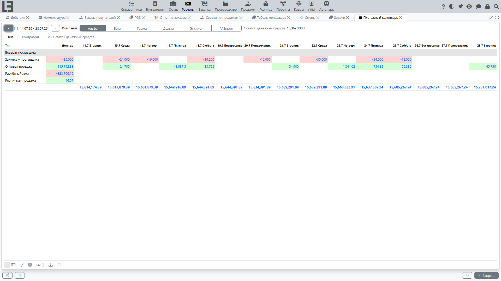

## Задолженность

В разделе «Расчёты» документы и платежи трактуются как **записи задолженности** со знаком: [поступления](bills.md) и входящие платежи создают долг в одну сторону, [реализации](invoices.md) и исходящие платежи — в другую. Различают две величины:

- **Долг по контрагенту / договору** — сумма со знаком всех активных документов [контрагента](../masterdata/partners.md) или [договора](../masterdata/contracts.md). Этот итог существует, как только существует документ; он **не** зависит от разнесения. Суммы приводятся к валюте по умолчанию (если пересчёт не отключён в [настройках](settings.md)).
- **Остаток (Осталось)** — для отдельного документа это его сумма минус **разнесённые** платежи. Именно эта величина уменьшается, когда вы разносите платёж.

Что важно понимать:

- документ в статусе **«Отменен»** исключается из любого расчёта задолженности;
- **Просроченный долг** — это часть долга, у которой дата **«Оплатить до»** уже в прошлом;
- разнесение влияет только на показатели уровня документа — **«Осталось»** / **«Оплачено»**; итог по контрагенту отражает документ с момента его ввода.

Выделенные представления **«Долги по контрагенту»** и **«Долги по договору»** перечисляют каждую запись задолженности (тип, номер, дата, **«Оплатить до»**, компания, сумма, **«Осталось»**, накопительный **«Долг»**) с фильтром **«Просроченные»** и показывают итоги **«Долг»** и **«Просроченный долг»** по контрагенту/договору. В **«Долгах по контрагенту»** у каждой записи дополнительно показаны **«Дней просрочки»** и **«Интервал просрочки»** на сегодня (см. раздел «Задолженность по срокам долга» ниже).

## Как погашается задолженность

1. Создайте [платёж](payments.md).
2. Разнесите платёж на документ (или на несколько документов). Разнесение может произойти и **автоматически**, если **«Ссылка»** платежа содержит номер документа.
3. После разнесения остаток документа (**«Осталось»**) уменьшается; когда он достигает нуля, документ помечается статусом **«Оплачено»**.

Если платёж разнесён на несколько документов, остаток уменьшается по каждому документу на соответствующую сумму.

## Календарь платежей

**«Платежный календарь»** (**«Расчёты» → «Отчётность» → «Платежный календарь»**) показывает остаток задолженности, распределённый по диапазону дат, — чтобы видеть, когда деньги должны прийти и уйти.

Структура формы:

- сверху выбираются **компания** и **интервал дат**; кнопки **\<** / **\>** сдвигают интервал на месяц назад/вперёд. Изначально интервал — *сегодня … сегодня + 14 дней*.
- **«Остаток денежных средств»** показывает текущий остаток по счетам компании.
- **«Долг до»** — остаток задолженности, у которого дата **«Оплатить до»** приходится на период до начала интервала.
- далее идёт **по одной колонке на каждую дату** интервала; в каждой ячейке — чистое изменение долга на этот день. В подвале колонки показан **прогнозный остаток** — накопительный остаток (остаток денежных средств плюс накопленный долг) на эту дату.
- ячейки подсвечиваются зелёным (плюс) или красным (минус).

У календаря две вкладки-разреза — **«Тип»** и **«Контрагент»** — плюс график остатка денежных средств.

 Срок оплаты берётся из сохранённого в каждом документе значения **«Оплатить до»** (вычисляется один раз из условий оплаты при вводе), а не пересчитывается на лету.

Щелчок по ячейке **«Долг до»** или ячейке даты раскрывает соответствующие документы (список долгов, отфильтрованный по компании, типу, контрагенту и сроку оплаты).

### На что смотреть, если календарь «пустой» или даты неверные

Проверьте:

- заполнены ли в документах **условия оплаты / «Оплатить до»**;
- действительно ли выбранный **интервал дат** покрывает сроки оплаты;
- не исключены ли документы статусом (например, «Отменен»).

## Задолженность по срокам долга

**«Расчёты» → «Отчётность» → «Задолженность по срокам долга»** раскладывает остаток долга каждого контрагента по длительности просрочки на выбранную дату — обычный отчёт по срокам дебиторской и кредиторской задолженности.

Структура формы:

- сверху выбираются **компания** и **дата** (по умолчанию — сегодня); переключатель **«Поставщики»** переводит отчёт с покупателей (контрагенты должны компании) на поставщиков (компания должна контрагентам) — со стороны поставщиков суммы показываются положительными;
- по одной строке на контрагента: **«Менеджер по продажам»**, **«Итого»** долга на дату, часть, у которой **«Срок не наступил»**, по колонке на каждый интервал просрочки (**1-30**, **31-60**, **61-90** при интервалах по умолчанию) и колонка **«> 90»** для долгов старше последнего интервала;
- фильтр **«Мои покупатели»** оставляет только контрагентов, у которых менеджер по продажам — текущий пользователь;
- нижняя таблица перечисляет долги выбранного контрагента с **«Дней просрочки»**, **«Интервалом просрочки»**, суммой и **«Долгом»** — остатком на дату.

Как считаются показатели:

- долг просрочен на дату, если его **«Оплатить до»** раньше этой даты; дни просрочки считаются от **«Оплатить до»**;
- остаток на дату — сумма документа минус разнесённые платежи с датой не позже этой даты, поэтому отчёт можно построить и на прошедшую дату;
- долги без **«Оплатить до»** (например, неразнесённые платежи) попадают в **«Срок не наступил»**;
- показатели контрагента — нетто, как **«Долг»** и **«Просроченный долг»** на его карточке: документы в обе стороны суммируются со знаком, поэтому на сегодня сумма интервалов совпадает с **«Просроченным долгом»** карточки; у контрагента, который одновременно должен и которому должны, ячейка может оказаться отрицательной.

Границы интервалов задаются на вкладке **«Интервал просрочки»** формы [«Настройки»](settings.md).

## Акт сверки взаимных расчетов

**«Расчёты» → «Отчётность» → «Акт сверки взаимных расчетов»** формирует сверку расчётов с контрагентом за период: начальный остаток, все документы периода в виде ведомости и конечный остаток, а также печатный двусторонний акт для отправки контрагенту на подтверждение. Та же форма открывается кнопкой **«Акт сверки взаимных расчетов»** на карточке [контрагента](../masterdata/partners.md).

Структура формы:

- сверху выбираются **компания**, **контрагент** и **период** (по умолчанию — с первого дня текущего года по сегодня); кнопка **«Печать»** формирует печатную форму — она доступна, когда в периоде есть документы, для периода без них форма всё равно показывает остатки;
- строка итогов показывает **«Начальный остаток»**, обороты периода по **«Дебету»** и **«Кредиту»** и **«Конечный остаток»**;
- таблица перечисляет действующие долговые записи контрагента по компании с датой в периоде — тип, номер, дата; сумма попадает в колонку **«Дебет»** для документов, увеличивающих долг контрагента (реализации, исходящие платежи), и в колонку **«Кредит»** для уменьшающих его (поступления, входящие платежи); **«Редактировать»** открывает документ.

Как считаются показатели:

- остатки — это [долг](#задолженность) контрагента по компании на дату: начальный — на день перед началом периода, конечный — на его последний день; поэтому конечный остаток периода, заканчивающегося сегодня, — это **«Долг»** карточки контрагента по этой компании; положительный остаток означает долг контрагента перед компанией, отрицательный — долг компании перед контрагентом;
- конечный остаток равен начальному остатку плюс оборот по дебету минус оборот по кредиту;
- суммы — в валюте показателей задолженности: в валюте по умолчанию или в собственной валюте контрагента, если пересчёт отключён в [настройках](settings.md);
- отменённые документы не учитываются, как и во всех показателях задолженности.

Печатная форма построена как остальные нейтральные печатные формы: шапка компании, контрагент, дата, период и валюта, затем ведомость с колонками **«Дебет»** / **«Кредит»** под заголовком **«По данным»** каждой из сторон — колонки контрагента остаются пустыми для заполнения, — строки начального остатка, оборотов и конечного остатка, фраза о том, кто кому должен на конец периода, и место для подписи каждой стороны. Подписи формы берутся из того же словаря ресурсов, что и интерфейс (`$R{ключ}` в шаблоне, на языке сервера), поэтому один шаблон (`ReconciliationStatement.jrxml`) служит всем редакциям, а в собственном шаблоне так же можно использовать любой ключ словаря. Шаблон один на всю систему: в блоке **«Шаблон акта сверки»** формы [«Настройки»](settings.md) есть **«Открыть»** (скачивает текущий jrxml, встроенный или загруженный), **«Загрузить»** (заменяет встроенную форму собственным файлом) и **«Сбросить»** (возвращает встроенную).

Подробнее про параметры: [Настройки и справочники](settings.md).